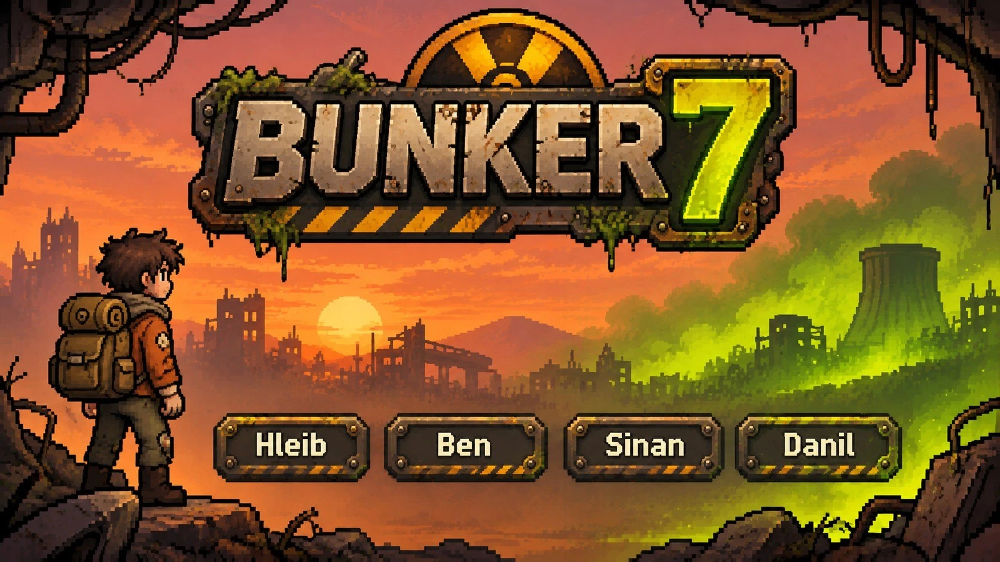
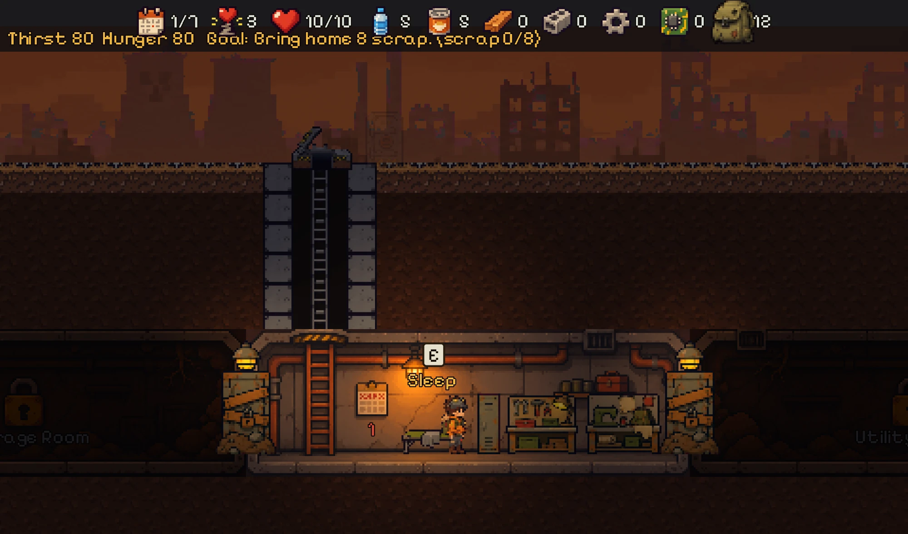

# Bunker 7

*A group game jam project by Hleib, Ben, Sinan and Danil. Theme: Bounce Back.*

The bombs fell, and you are the last survivor in Bunker 7. A convoy will come for you on Day 7, but only if your radio beacon is built by then. Seven days is not long when everything you need is out in the ruins.

## The game

Every day you climb the ladder, open the hatch and step out into the wasteland. The hatch sits in the middle of the world, so you can go left or right. You chop trees, break rocks and dig for wood, concrete, scrap and circuits while zombies shuffle toward you through the ruins.

Radiation is the real clock. The farther you walk from the hatch, the stronger it gets, and your geiger counter ticks faster and faster. Push too far and your health starts to drain. Your backpack is small, so you have to decide what is worth carrying home.

You also have to stay alive the boring way. Thirst and hunger drain while you are out. Water you find is dirty and raw meat is dangerous, so you bring them home, run the water through the filter and cook the meat on the stove. A crafts book in the pause menu tells you what everything is, where to find it and how to make it.

If you die out there, you bounce back. You wake up in the bunker and the game goes on, but every bounce costs you, and you only get a few. Easy gives you 5 bounces, Normal 3 and Hard 2.

## The bunker

Home is a place you walk through, not a menu. A ladder shaft drops into a cramped cutaway with rooms side by side: a garden, a storage room, your bedroom, a utility room and the radio room. Most of them start boarded up, and you earn each one back. Inside you will find:

- a workbench in every room, where you build what the bunker needs
- an upgrade bench that turns your torn bag into a bigger backpack, in four sizes
- a locker, a calendar and a cot to sleep on
- the radio, which is the whole point

Sleeping ends the day. At night things can happen, from a quiet few hours to a poisoned can, a rain shower, a trader rat or a horde at the door.

## Beyond the ruins

You are not stuck on the surface. From day 2 you can climb down into the Old Mine, a dark tunnel full of ore, mushrooms and cave zombies. From day 4 you can walk into the Bomb Crater, where the bomb landed: the radiation is brutal and the zombies hit hard, but the best loot is down there, including the part your radio needs. Each day also has a goal, and a storm hits on day 3.

## How to win

Build the radio beacon, survive until Day 7 and be alive when the convoy arrives. Lose all your bounces and it is game over.

## Play it

Bunker 7 runs in the browser.

## The team

Bunker 7 was made by four people for a game jam: Hleib, Ben, Sinan and Danil.
